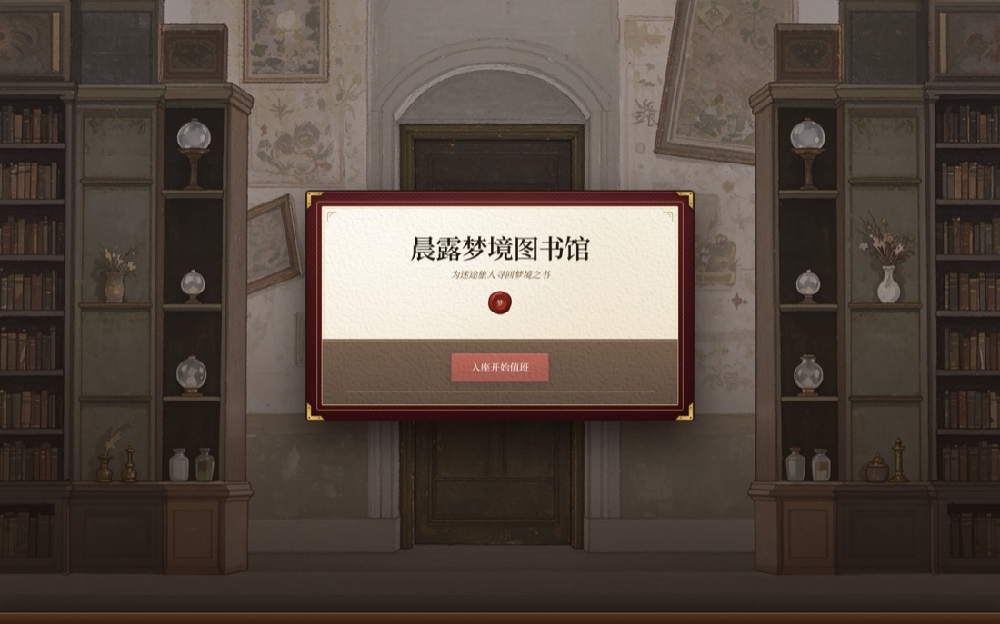
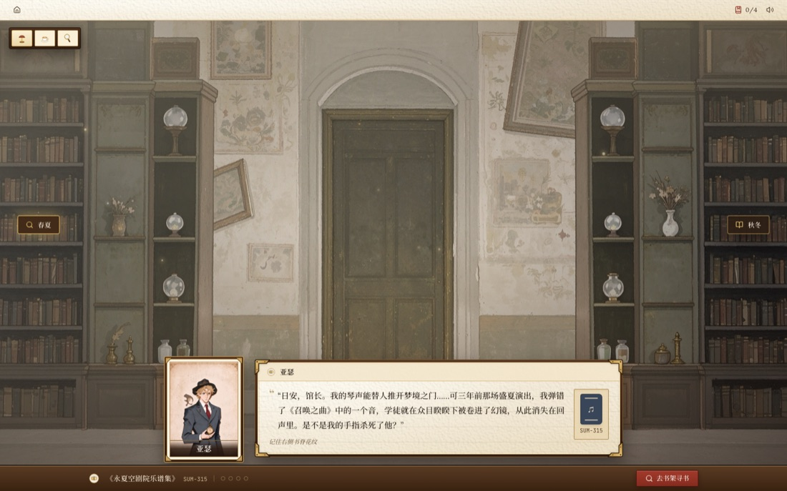

# 晨露梦境图书馆 · The Morning Dream Library

**在线试玩**：https://gigige1999.github.io/dreambook/

> 第一人称清新治愈系英伦复古梦境图书馆解谜游戏。以四季梦书为引，为迷途旅人解开被时光封存的执念。



## 玩法

你是一座只在晨露时分开门的图书馆的「守梦人」。四季更迭，四位带着旧事而来的梦旅人会依次叩响馆门：

**门铃 → 入座倾听 → 四季书架寻书 → 翻页拾取信物 → 塔罗牌阵解开心结 → 收下临别信物**

每一章对应一个季节（春·温室梦芽 / 夏·幻声剧院 / 秋·记忆邮局 / 冬·钟楼雪夜），拥有独立的三层手绘书架、机关抽屉与专属谜题。



## 特性

- **开场即为叙事**：首次进入播放馆外白天 → 黄昏 → 黑夜的光线轮转，背景故事以极简字幕呈现，不使用弹窗
- **四季过场**：每位来客抵达时先完整播放其季节的馆外实景，再浮出古董相框肖像；开门后以三帧过场（关门 → 推门 → 踏光而入）接入馆内
- **四套手绘场景**：春/夏/秋/冬各有一套书架、机关与谜题
- **克制的界面**：单行顶栏、纯图标案头工具、一条案头信息条，任何时刻只暴露一个主行动

## 技术栈

React 19 · TypeScript · Vite 8 · Tailwind CSS 4 · lucide-react

## 本地运行

```bash
npm install
npm run dev      # http://localhost:3000
npm run build    # 产物在 dist/
npm run lint     # tsc --noEmit
```

## 目录结构

```
src/
├── App.tsx                  # 阶段状态机：首页 / 开场 / 迎客 / 桌前 / 书架 / 翻书 / 解结 / 结算
├── components/
│   ├── OutdoorCinematic.tsx # 首次进入的晨昏轮转 + 极简字幕
│   ├── SeasonEntrance.tsx   # 四季室外实景 → 肖像卡 → 三帧进门过场
│   ├── LibraryStage.tsx     # 主场景（访客、案头工具、书架入口）
│   ├── DeskWorkbench.tsx    # 案头信息条（书目 / 信物进度 / 主行动）
│   ├── ShelfSearchModal.tsx # 四季书架寻书
│   ├── BookInspectionModal.tsx # 梦境书翻阅与信物拾取
│   ├── KnotResolutionModal.tsx # 塔罗牌阵解结
│   └── ArchiveDrawer.tsx    # 梦境手帐
├── data/libraryCases.ts     # 四位来客的剧本、线索、谜题与信物
└── assets/scene/            # 场景与角色美术（已压缩为 web 尺寸）
```

## 说明

- `素材/` 为原始美术源文件（约 180 MB），未纳入版本库；`src/assets/scene/` 中是压缩后的发布用版本。
- 调试快捷键：`Cmd/Ctrl + Shift + Q` 一键通关，`Cmd/Ctrl + Shift + I` 重看开场。
